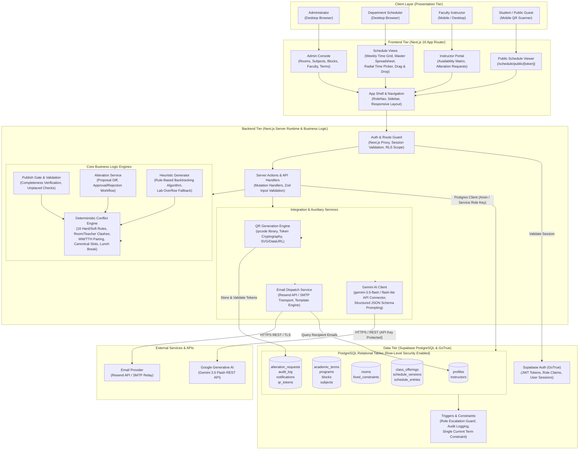
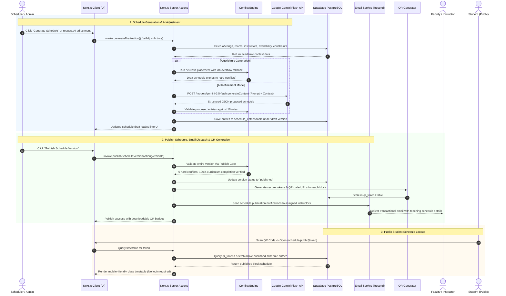

# AlterSched System Architecture & Block Diagram

This document outlines the high-level system architecture, block diagram, component decomposition, and data flow for **AlterSched**, an academic scheduling and resource management system tailored for collegiate and departmental scheduling.

---

## 1. System Architecture Block Diagram

---

## 2. Component Decomposition

### A. Frontend Layer (Next.js 16 App Router)
- **Framework & Libraries**: Next.js 16 (React 19, TypeScript Strict Mode), Tailwind CSS, Vanilla CSS styling tokens, Bootstrap Icons.
- **Key Modules**:
  - **Weekly Schedule Grid & Spreadsheet View**: Interactive matrix displaying academic sessions by timeslots and day pairings (MW, TTH, Single Day).
  - **Radial Time Picker**: Circular analog-style clock face with strictly predetermined `:00` / `:30` minute pills and automatic course duration calculations.
  - **Conflict & Advisory Badges**: Real-time visual warnings for room clashes, faculty double-booking, and irregular day pairings.
  - **Public Schedule View**: Read-only, responsive timetable screen accessible via scanned QR codes without requiring login credentials.

### B. Backend Layer (Server Actions & Domain Engines)
- **Server Runtime**: Node.js Next.js Server Actions with Zod schema validation and role-based authorization guards.
- **Deterministic Conflict Engine (`src/lib/conflict-engine`)**:
  - Independent, deterministic verification engine evaluating 16 hard and soft constraints.
  - Enforces canonical slot alignment (`08:00`, `09:30`, `11:00`, `13:00`, `14:30`, `16:00`, `17:30`, `19:00`), lunch clearance (`12:30–13:00`), faculty availability, and room capacity.
- **Heuristic Schedule Generator (`src/lib/ai/gemini-client.ts`)**:
  - Algorithmic scheduler using priority heuristics, course unit splits (1.5h Lec + 1.5h Lab), canonical day pairs (Monday/Wednesday, Tuesday/Thursday), and automatic **computer laboratory overflow fallback** when standard lecture rooms are fully occupied.
- **Publish Gate**:
  - Guard preventing publication of incomplete or conflicting drafts.
- **Alteration Service**:
  - Manages schedule change requests submitted by instructors with impact preview, approval/rejection pipelines, and audit trails.

### C. External Integrations
1. **Google Gemini Flash API (`gemini-3.5-flash` / `gemini-3.5-flash-lite`)**:
   - Used for optional AI-assisted schedule adjustments and human-language constraint refinement.
   - Secure server-to-server HTTPS communication using server-side environment variables (`GEMINI_API_KEY`).
2. **Email Notification Service (`Resend API / SMTP Transport`)**:
   - Dispatches transactional emails to faculty members upon schedule publication or alteration resolution.
3. **QR Code Engine (`qrcode`)**:
   - Generates cryptographically unguessable tokens (`qr_tokens` table) and renders QR codes (Data URL / SVG) for student blocks.

### D. Data Tier (Supabase PostgreSQL)
- **Supabase PostgreSQL 15+**:
  - 17 relational tables organized with foreign keys, composite indexes, and strict cascade rules.
  - Row-Level Security (RLS) active across all tables.
  - Database triggers preventing unauthorized role elevation and enforcing term uniqueness.
- **Supabase GoTrue**:
  - Handles secure password hashing, session tokens, JWT claims, and authentication state.

---

## 3. Data Flow

### End-to-End Data Flow Description
When a scheduler initiates timetable drafting, Next.js Server Actions retrieve academic offerings, instructor availability matrix records, room specifications, and existing blackout constraints from Supabase PostgreSQL. The backend executes the deterministic heuristic algorithm—placing classes according to collegiate MW / TTH day-pairing conventions and invoking computer lab overflow when lecture rooms are saturated—or alternatively invokes the Google Gemini Flash REST API with strict JSON schema prompts for natural-language schedule adjustments. All output entries are validated in memory by the Conflict Engine against 16 hard and soft constraint rules before being written to PostgreSQL under a draft `schedule_version`. Once validated and approved through the Publish Gate, the system transitions the version status to `published`, triggers the QR Generation service to create unguessable block lookup tokens in the `qr_tokens` table, and dispatches email notifications to all assigned faculty members via the Resend API. Students and guests scan the generated QR codes to access the read-only public schedule view (`/schedule/public/[token]`), where the server resolves the token against the active published schedule and renders the clean timetable without exposing administrative credentials.
