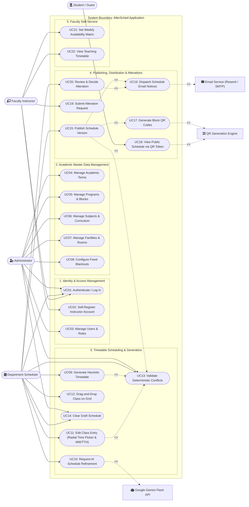

# AlterSched Use Case Diagram & Specifications

This document defines the actors, use case diagram, and detailed use case specifications for **AlterSched**, detailing the functional interactions across the system.

---

## 1. System Use Case Diagram

---

## 2. Actor Catalog

| Actor | Category | Description |
| :--- | :--- | :--- |
| **Administrator** | Human (Internal) | Institutional superuser responsible for academic terms, curriculum configuration, facilities, user roles, and system constraints. |
| **Department Scheduler** | Human (Internal) | Academic officer responsible for creating, editing, validating, optimizing, and publishing semester class timetables. |
| **Faculty Instructor** | Human (Internal) | Teaching staff member who provides availability slots, reviews assigned teaching loads, and submits schedule alteration requests. |
| **Student / Public Guest** | Human (External) | Enrolled students or visitors who scan physical/digital QR codes to view published block schedules without logging in. |
| **Google Gemini Flash API** | Machine (External Service) | Cloud Generative AI endpoint used by the scheduler for natural-language schedule adjustments and heuristic refinement. |
| **Email Service (Resend/SMTP)** | Machine (External Service) | Transactional email provider delivering schedule publishing announcements and alteration status notifications. |
| **QR Generation Engine** | Machine (Internal Service) | Service providing secure token issuance and image encoding (`qrcode` library) for public block schedule lookups. |

---

## 3. Detailed Use Case Specifications

### UC09: Generate Heuristic Timetable
- **Primary Actor**: Department Scheduler, Administrator
- **Pre-conditions**:
  1. Active academic term is configured.
  2. Student blocks have class offerings associated with subjects.
  3. Classrooms, laboratories, and instructors with qualifications are present in the system.
- **Main Flow**:
  1. Scheduler clicks **"Generate Schedule"** and chooses the scope (selected block or all blocks).
  2. The system invokes `generateHeuristicDraft`.
  3. The algorithm resolves 1.5h Lec + 1.5h Lab courses into paired slots (MW or TTH) at identical timeframes.
  4. The algorithm prioritizes standard lecture halls; if all lecture rooms are occupied, it automatically falls back to available computer laboratories.
  5. Deterministic Conflict Engine verifies zero hard rule collisions (faculty, room, student block, lunch break).
  6. Generated timetable entries are saved to the current draft version and rendered in the weekly schedule grid.
- **Post-conditions**: Complete, conflict-free draft entries are staged in `schedule_entries`.

---

### UC10: Request AI Schedule Refinement
- **Primary Actor**: Department Scheduler
- **Secondary Actor**: Google Gemini Flash API
- **Pre-conditions**:
  1. A draft schedule exists.
  2. Valid `GEMINI_API_KEY` is configured on the server.
- **Main Flow**:
  1. Scheduler opens the AI adjustments dialog, selects the target block, and enters natural-language preferences (e.g., *"Prioritize morning slots, avoid classes after 5 PM"*).
  2. Server builds structured JSON context containing existing block placements, eligible rooms, and instructor qualifications.
  3. System dispatches a REST request to `gemini-3.5-flash:generateContent`.
  4. Server parses the structured response and runs all proposed entries through the Conflict Engine.
  5. Accepted entries are staged in the draft schedule.
- **Post-conditions**: Schedule draft is updated with AI-suggested adjustments that satisfy institutional constraints.

---

### UC11: Edit Class Entry (Radial Time Picker & MW/TTH Day Pairing)
- **Primary Actor**: Department Scheduler
- **Pre-conditions**: Schedule version is in `draft` status (not locked/published).
- **Main Flow**:
  1. Scheduler clicks an entry cell on the weekly grid or master spreadsheet.
  2. System opens the **Edit Class Schedule Entry** 3-column modal.
  3. Scheduler toggles between **Single Day**, **MW (Mon/Wed)**, or **TTH (Tue/Thu)**.
  4. For dual-session subjects (e.g., 1.5h Lec + 1.5h Lab), both Session 1 and Session 2 cards are displayed with synchronized start/end times.
  5. Scheduler interacts with the **Radial Time Picker** to pick the hour on the circular clock face and select predetermined `:00` or `:30` minute pills.
  6. System automatically recalculates the End Time based on the subject's duration (e.g., `08:00` $\rightarrow$ `09:30` for 1.5h).
  7. Scheduler selects room and instructor for each session.
  8. System validates against conflicting entries and saves changes.
- **Post-conditions**: `schedule_entries` updated in PostgreSQL with immediate grid re-rendering.

---

### UC15: Publish Schedule Version & Dispatch Notifications
- **Primary Actor**: Department Scheduler, Administrator
- **Secondary Actors**: Email Service (Resend/SMTP), QR Generation Engine
- **Pre-conditions**:
  1. Schedule version is in `draft` status.
  2. Conflict Engine detects 0 hard violations.
- **Main Flow**:
  1. Scheduler clicks **"Publish Schedule"**.
  2. Publish Gate executes full integrity validation.
  3. Version status transitions from `draft` to `published`.
  4. System calls the QR service to generate secure tokens in `qr_tokens` for every block.
  5. System collects assigned instructors and dispatches personalized schedule emails via Resend.
  6. In-app notifications are generated in the `notifications` table.
- **Post-conditions**: Schedule is locked, QR tokens are active, and faculty receive teaching assignments via email.

---

### UC18: View Public Schedule via QR Token
- **Primary Actor**: Student / Public Guest
- **Secondary Actor**: QR Generation Engine
- **Pre-conditions**: The academic block schedule has been published and assigned a token.
- **Main Flow**:
  1. Student scans the printed or displayed QR code using a mobile device camera.
  2. Device opens the URL: `/schedule/public/[token]`.
  3. Server verifies token validity in the `qr_tokens` table.
  4. Server fetches published schedule entries for the corresponding block.
  5. Client displays a responsive, clean timetable view of classes, rooms, and faculty without requiring user login.
- **Post-conditions**: Block schedule is viewed publicly in read-only mode.

---

### UC19: Submit Alteration Request
- **Primary Actor**: Faculty Instructor
- **Pre-conditions**: Instructor has an assigned class in a published schedule.
- **Main Flow**:
  1. Instructor navigates to their personal schedule portal.
  2. Instructor selects a class session and clicks **"Request Alteration"**.
  3. Instructor proposes a new day, timeslot, or room and provides a reason.
  4. System previews potential conflicts and submits the request to `alteration_requests` with status `pending`.
- **Post-conditions**: Schedulers receive notification of pending alteration for review.

---

### UC20: Review & Decide Alteration Request
- **Primary Actor**: Department Scheduler
- **Secondary Actor**: Email Service
- **Pre-conditions**: An alteration request is in `pending` status.
- **Main Flow**:
  1. Scheduler opens the Alterations review panel.
  2. System displays a side-by-side diff comparing current placement with proposed placement.
  3. System runs Conflict Engine check on the proposed shift.
  4. Scheduler clicks **Approve** or **Reject** (with comments).
  5. If approved, system creates an amended draft version and updates the entry.
  6. System dispatches an email notification to the instructor notifying them of the decision.
- **Post-conditions**: Request status updated to `approved` or `rejected`, audit log written, and instructor notified.
